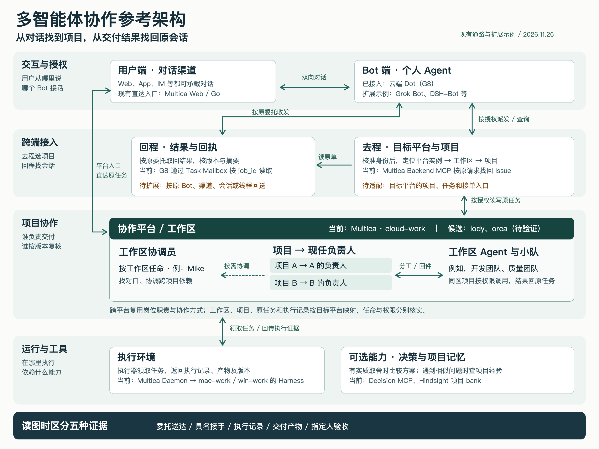
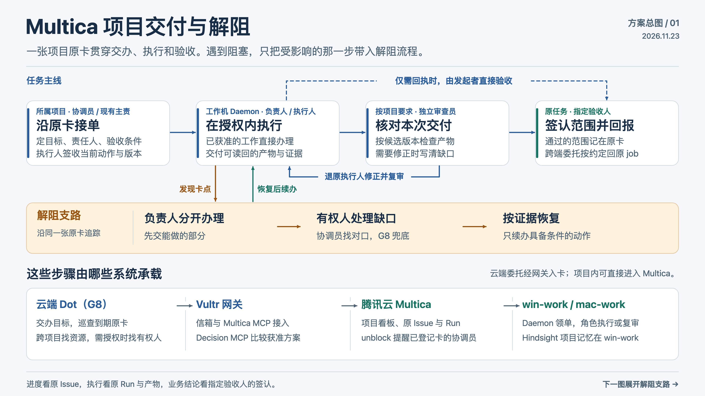
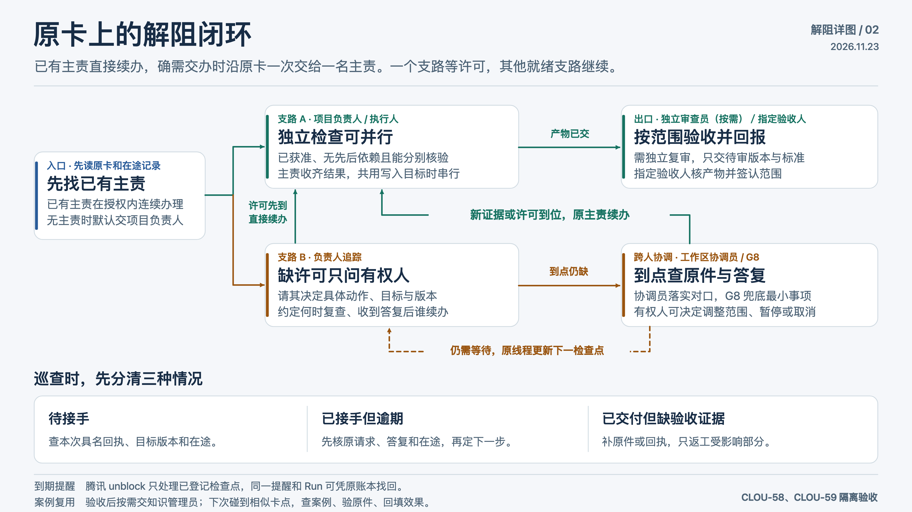

# 多智能体项目协作与解阻方案（当前实现：Multica）

**已有主责直接续办，确需交办时沿原卡一次交给一名主责。** 首次交办写清交付目标、已知事实与在途工作、授权边界、验收人和回报时间。阶段产物交付或批次核收后，主责对照整卡目标，直接续办已获准的下一项；约定只做本阶段时，交清余项、接续人及所需决定。独立工作可并行提速时，由主责分工并收齐结果。缺许可，只请有权人决定具体动作。需独立复审，只交待审版本和标准。到期先核原请求、答复和在途。确需换人，只交剩余工作，原主责跟到新主责签收。

例如，CLOU-59 的清单核算已获准，导出还缺许可。凡人项目负责人直接交付清单，只问 Mike 是否批准该版本导出。Mike 决定暂停导出，后续许可到位仍由凡人负责人接续。发起者验收了这次流程演练。[2026-11-23 隔离验收记录](../harness-role-guide.md#项目负责人怎么配)

## 协作架构分层图

[高清 PNG](multica-workspace-architecture.png) · [可编辑 SVG](multica-workspace-architecture.svg)

**图中可替换的是协作平台。** 当前项目用 Multica 承载工作区、项目和原任务。lody、orca 仅作候选示例，接入前需核实其实际接口、权限和可读回的记录。图上的工作区、负责人、小队和执行记录描述协作职责，各平台可用自己的对象或明确的岗位约定承接。

| 环节 | 各平台要能回答的问题 | 当前实现与扩展边界 |
|---|---|---|
| 对话与授权 | 谁在什么会话发起，批准了哪些动作？ | 云端 Dot（G8）代为交办；Multica Web／Go 可直达原卡。Web、App、IM 渠道与个人 Bot 可分别扩展，Grok Bot、DSH-Bot 为候选。 |
| 去程与回程 | 派到哪个平台实例、工作区和项目？结果回给谁？ | 当前网关按身份和稳定请求关联原 Issue，G8 按原卡或信箱 job 读回。扩展时按 Bot 和用户的授权选项目，重名先确认；将原请求绑定发起 Bot、渠道及会话／线程，重复投递先查原回执。多 Bot 定向回送待验证。 |
| 项目协作 | 谁主办，谁能协作，谁验收？ | 负责人按项目任命；工作区协调员按需找对口；开发和质量小队供同区项目按权限复用。跨平台可沿用角色模板和分工，目标工作区重新核实任命与调用权限。 |
| 执行与验收 | 哪次执行交付了哪个版本，谁签认？ | Multica 记录 Issue、Run 和验收回件，Daemon 驱动工作机执行。候选平台可映射到原生任务、作业记录、产物及签认凭据。 |

**换平台时，用一笔任务验证映射。** 在目标平台选定一个已授权项目，派发后按原请求找回同一任务，核对具名接手、执行记录、产物版本及验收人，再按约定回程读回结果。若平台只支持查询，可以先开放查询；派发、自动唤醒和原会话送达各自按实测标明。下文的交付与解阻案例取自当前 Multica 实现。[现有网关与接单](../../mcp/README.md) · [工作区协作与复审](../../skills/workspace-coordination/SKILL.md) · [回程实测](../workflow-reporting.md)

## 一项任务怎样走完

总图可直接用于转发或投屏。[高清 PNG](multica-delivery-solution.png) · [可编辑 SVG](multica-delivery-solution.svg)

| 时点 | 谁做什么 | 在哪里确认 |
|---|---|---|
| 交办 | 目标明确时可直达项目负责人，需团队承接的软件实现交开发团队。局部协助沿原线程 @ 小队，整卡移交时才指派小队。要找人、查跨项目进度或转交工作时找现任工作区协调员。G8 从云端单向下发已获准的任务，沿原委托关联唯一原卡。 | 原线程有执行人或小队 leader 对**本次动作、目标和版本**的接手回件。信箱落盘、Run 启动各有自己的记录。 |
| 执行与并行 | 比如核对输入和校验一份已生成的副本，可由同一主责在父 Run 内并行分工，逐项收齐结果。须用上一步产物的步骤依次执行，共用写入目标只留一名写入者。 | 原主责回原卡交付产物、版本和验证结果。 |
| 授权或独立复审 | 原授权未覆盖的动作，如向新目标导出，由有权人单独决定对象、版本和范围。候选产物、版本和标准按项目路由交质量团队或原卡约定的审查人。自动交接时只切一次状态。发现缺口退原执行人修正后复审。 | 许可回件只覆盖批准的动作。复审意见关联被审版本，审查人须独立于候选制作。达到返工上限时按项目约定处置。 |
| 验收与回报 | 指定验收人按原条件签认具体范围。普通任务回原卡；约定回信箱的，回同一 `job_id`，按版本与摘要读回。 | 分别记录业务签认和回程送达。回程故障时保留原件，恢复后只补经核实缺少的回执。 |

看板状态及自动处理人以项目配置为准。只需回执时，按原约定交付。G8 沿原回程收取回执及已有验收结论。[协作规范](../../skills/workspace-coordination/SKILL.md) · [工作流与跨端回报](../workflow-reporting.md)

需要跨项目取舍或讨论长期方向时，G8 可根据各项目提供的事实，比较选择、代价和实施条件，交付建议或 ADR 草案。草案写清推荐依据、首个可验证动作和重新评估的条件。具备决定权的人明确采纳后，主责按原 Issue 和实际授权推进相应动作。项目负责人同时继续推进已获准的工作。

## 有一步走不通，怎样继续

需要说明“下一步谁来做”时，可单独使用这张图。[高清 PNG](multica-issue-unblock-loop.png) · [可编辑 SVG](multica-issue-unblock-loop.svg)

| 原卡上看到什么 | 这一轮应该做什么 |
|---|---|
| 已有方案，没人签收当前动作 | 查原请求、具名回执和在途 Run。查不清就保留“待接手”；确认未收到、无同一动作在途且获准时，唯一派发者沿原单提醒一次。旧版本的签收仅作历史。 |
| 已接手，到了复查点 | 原主责查新增答复、已交产物和仍可做的动作。原因未明，先做一个会改变下一步的检查。缺许可就指明谁能决定、最迟何时需要答复，以及答复后谁做什么。 |
| 有回报，验收还缺证据 | 优先补原产物或原回执。发现产物确有问题，才返工受影响的部分；独立支路照常交付。首件通过只签认首件。 |
| 找不到有权人、已到最迟决定时间，或同因反复且本地无可办事项 | 主责继续跟原卡，协调员落实具名对口。确需公子决定或授权时，当前主责在原线程提一个可回答的问题，附证据、影响和答复后谁续办。G8 查询并汇报原卡进展和缺口。 |

同一检查点到期，先核原请求、答复和在途；已有业务动作只补缺少的证据。整卡确无可行动作时才建议标记阻塞。[解阻办理与复核](../project-unblock-loop.md)

## 架构怎样支撑这条原卡

| 要回答的问题 | 系统与责任人 |
|---|---|
| 进度、主责和验收结论在哪里？ | 腾讯云 Multica 保存项目、Issue、Run 和回件。win-work、mac-work 上的 Daemon 领取 Run，由实际绑定的角色执行或复审。项目负责人主责推进，指定验收人签认。 |
| 跨端委托是否抵达？ | G8 通过获准的 Vultr 网关访问 Multica 或 Task Mailbox。信箱保存原委托和版本化结果，存储在 win-work。G8 查落盘、接手、运行和已签认的验收结论，按原单收结果与反馈。腾讯终态补报器仅给已登记 Run 补运行事实。 |
| 谁发现到期，谁实际提醒？ | G8 巡查查信箱增量和原卡到期项，信箱空页时仍查原卡。项目主责处理到期事项。获准由腾讯 `unblock` 提醒的检查点，由这一路提醒所属工作区的现任协调员。空扫可用缓存，新提醒发送前核权威任命。断连或任命不明就暂缓，结果未知沿原账本对账。 |
| 遇到选择或重复问题时用什么？ | 已获准路线之间有实质取舍，负责人按权限用 Decision MCP 比较并回填采用与结果。遇到相似症状，负责人或协调员查项目 Hindsight bank，再用现场证据核适用性。实际验收人在原卡注明已有案例 ID、已交知识管理员或一次性问题略过；知识管理员异步查重整理，复用者回原卡反馈效果。 |

只靠人工看板，实施最轻，但到点容易漏跟；让每个阻塞都自动派给下一角色，又会把正在办理的工作重派一遍。现行方案把自动化用在**容易漏、容易重复、能凭 ID 核对**的环节，把生产许可、范围变更和验收留给具名责任人。仅剩等待时，到点要取得新证据、找到能作决定的人，或记录有权方的暂停决定。只把日期向后移，原主责仍需跟进。[腾讯提醒与任命缓存](../unblock-operations.md#腾讯协调端与-g8-原卡交接) · [G8 巡查指引](../g8-project-patrol-prompt.md) · [终态补报边界](../tencent-run-reporter.md)

## 哪些已有实测

- **交付和解阻可以同时推进。** CLOU-58 的负责人在一个父 Run 收齐两份并行结果。模拟发布缺证时，两份成果均保留。CLOU-59 的清单合计 30、产物 28 字节，独立复算 SHA-256 一致；缺许可的导出由 Mike 具名处置。[CLOU-58 原卡验收](../project-unblock-loop.md#clou-58-隔离验收2026-11-23) · [CLOU-59 原卡验收](http://10.207.56.3:3000/cloud-work/issues/01a20668-d298-7b00-a405-dd00ec03963f#comment-01a2066f-a593-767c-9fb4-9cbae875be10)
- **同一检查点可以重放。** CLOU-59 用单卡独立账本发出一次真实提醒。Mike 运行中和完成后各重放一次，均找回同一提醒与 Run，新增 Run 为零。全卡共三个 Run，分别用于负责人执行、Mike 登记和 Mike 到期处置。[Mike 处置回件](http://10.207.56.3:3000/cloud-work/issues/01a20668-d298-7b00-a405-dd00ec03963f#comment-01a2066e-f202-71e7-b251-820f1257ab43)
- **验证边界。** 上述隔离卡验证了角色行为和单卡提醒。云端原会话还需验证按原 job 查到新增结果、核对具名接手和推进已核游标。真实项目的解阻耗时改善需要可比样本。持续比较首次记录阻塞到首个可验证动作的时间，以及同一已交或在途动作的重复派发次数。[验收边界与巡查配合](../project-unblock-loop.md#与现有-g8-定时巡查配合)

本页是面向分享的综合视图。2026-11-20 的两张图保留当时的部署和项目配置，便于追溯。[分层架构原图](multica-layered-architecture.svg) · [项目工作流原图](multica-project-workflow.svg)
